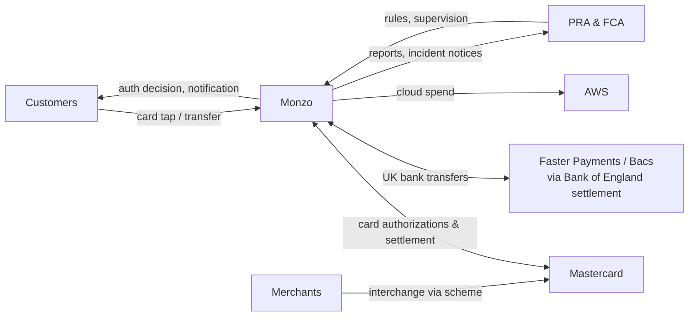
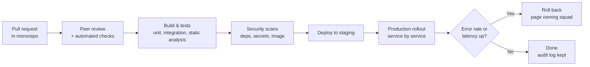

# Monzo: What DevOps Needs to Run a Bank in the Cloud

## Executive Summary

Monzo is a UK digital bank founded in 2015. It received a full banking licence in 2017 and has more than 12 million customers (**reported**, 2025). For the year to March 2025 it reported about £1.2 billion in revenue and its second year of profit (**reported**). Monzo runs almost entirely on AWS, as a very large set of small Go microservices on Kubernetes. The core problem DevOps solves for Monzo is **moving fast like a tech startup while meeting the reliability and audit demands of a regulated bank**: customers expect their card to work every time, and regulators expect proof that it will.

> **Data labels used in this document**
> - **Reported**: Monzo has stated it publicly (blog, annual report, talks), or it was widely covered in the press.
> - **Estimated**: a representative figure, given for illustration only.

---

## 1. What the Business Needs from Operations

Monzo earns money from card interchange fees, interest on balances and lending, paid subscriptions (Monzo Plus, Perks, Max), and business accounts. Every income source depends on one thing: **payments that work in real time, 24/7.**

| Business need | What it means for DevOps |
|---|---|
| Card payments approved in milliseconds | Card authorization path must be low-latency and always available |
| No lost or duplicated money | Strong consistency, idempotency and reconciliation |
| Regulators can audit everything | Every change and access is logged and traceable |
| Ship features weekly, not quarterly | Frequent, low-risk deploys by product teams |
| Survive a cloud or supplier failure | Tested resilience and exit plans, required by regulation |

### Stakeholders and how money and data move

---

## 2. Operating Model

What Monzo has described publicly (**reported**):

- **Product squads own services end to end**, including on-call for what they build.
- **A platform group** owns the shared foundation: Kubernetes, deployment tooling, the service library, data stores and observability.
- **One language and one repo.** Backend services are mostly Go in a **monorepo** that shares one service framework, so every service gets logging, metrics, tracing, RPC and auth the same way.
- **Thousands of small services.** Monzo described running more than 1,500 microservices in 2019, and the number has grown since.
- **Risk, compliance and security are built into the delivery process**, not run as a separate final sign-off. In a bank, the "three lines of defence" model still applies, so the audit trail has to come from tooling.

**Lesson:** a standard service template is what makes thousands of services manageable. Engineers mainly write business logic. The platform provides everything else.

---

## 3. What It Takes to Run Monzo: Layer by Layer

### 3.1 Cloud and Hosting

- **Purpose:** run the core banking platform: ledger, accounts, cards, payments, fraud and the app back end.
- **What Monzo uses:** AWS, mainly in the London region across multiple availability zones (**reported**). Connections to card and payment schemes need physical, dedicated network links into scheme networks, so some hardware sits in data centres to reach those networks (**reported**).
- **Why it matters:** UK rules on outsourcing (PRA SS2/21) treat a cloud provider as a material outsourcing. The bank must show resilience across zones, plan for provider stress, and keep a credible **exit plan**.

### 3.2 Compute and Containers

- **Purpose:** run thousands of services with predictable latency.
- **What Monzo uses:** Kubernetes, adopted early (around 2016) and run by Monzo's platform team. Services are built as containers from the monorepo.
- **Why it matters:** card authorization traffic spikes at lunchtime, on paydays and on Black Friday. Autoscaling must act faster than the spike, and noisy neighbours must not slow the payment path.

### 3.3 Networking and Service Communication

- **Purpose:** secure, observable service-to-service calls, plus fixed connections to Mastercard and Faster Payments.
- **What Monzo uses:**
  - **A service mesh** for RPC routing, retries and mTLS. Monzo used Linkerd early on and has since written about its own Envoy-based setup (**reported**).
  - **Strict network policies:** each service may call only the services it is allowed to.
  - **Dedicated, redundant links** to payment schemes.
- **Why it matters:** in a payments path, one slow dependency means declined cards. Timeouts, retries and circuit breakers have to be standard, not something each team adds by hand.

### 3.4 Data Layer

| Need | Technology (**reported**) | Why |
|---|---|---|
| Main service data | Apache Cassandra | Horizontal scale, survives node and zone loss |
| Distributed locking | etcd | Prevents double-processing of the same payment |
| Analytics and reporting | Cloud data warehouse (BigQuery has been described) plus dbt | Finance, regulatory and product analysis |
| Ledger correctness | Double-entry ledger with idempotency keys | Money is never created or lost |

**Lesson:** an eventually consistent database (Cassandra) can be used for banking if the application layer adds locks, idempotency and **continuous reconciliation** against the ledger.

### 3.5 Streaming and Messaging

- **Purpose:** decouple steps that don't have to happen during the card tap: notifications, feed items, fraud scoring updates, analytics.
- **What Monzo uses:** asynchronous message queues. NSQ was described early on, and Kafka is used for event streaming (**reported**).
- **Why it matters:** the payment approval must return in milliseconds. Everything else (the push notification, the spending category, the Pot round-up) happens asynchronously from events.

### 3.6 Security and Compliance

The busiest layer for a bank:

| Area | Requirement | Typical controls |
|---|---|---|
| Card data | **PCI DSS** | Small cardholder-data scope, tokenization, network segmentation, quarterly scans |
| Personal data | **UK GDPR** | Data minimization, retention rules, access logging |
| Operational resilience | **PRA SS1/21 / FCA PS21/3** | Important business services mapped, impact tolerances set and tested, in force from March 2025 |
| Outsourcing | **PRA SS2/21** | Cloud risk assessment, exit plans, audit rights |
| Financial crime | **AML / KYC rules** | Onboarding checks, transaction monitoring, sanctions screening |
| Accountability | **SM&CR** | Named senior managers own technology and resilience risk |

DevOps controls that put this into practice:
- **Least-privilege, time-limited access** to production, with every action logged.
- **No direct data access by default.** Break-glass access needs approval and is recorded.
- **Peer review** on every change in the monorepo. Pipeline logs serve as audit evidence.
- **Secrets in a vault**, encryption at rest and in transit, and mTLS between services.

**A reported warning:** in July 2025 the FCA fined Monzo about £21 million for weak financial-crime controls during its fast growth phase. **Lesson:** compliance controls must scale with customer growth. Onboarding and monitoring systems need the same capacity planning as the payments path.

### 3.7 Observability

- **Purpose:** catch payment problems before customers do, and give engineers enough data to fix them.
- **What Monzo uses:** Prometheus and Grafana for metrics, distributed tracing (Jaeger / OpenTelemetry style), and central logging (**reported**). The shared service library adds all three to every service automatically.
- **Key signals (representative):**
  - Card authorization success rate and latency (p99)
  - Faster Payments in/out success rate
  - Login success rate
  - Ledger reconciliation mismatches (should always be zero)
- **Why it matters:** banking incidents are reportable. You need a precise timeline: what broke, when, how many customers were affected and for how long.

### 3.8 DevOps and CI/CD

- **Purpose:** ship changes many times a day without risking money movement.
- **What Monzo does (**reported**):** hundreds of production deploys per day from the monorepo, using internal deployment tooling. Changes are small and owned by the team that wrote them.

- **Why it matters:** small, frequent changes are easier to roll back than big releases. For a regulator, the pipeline's log is the change-management record.

### 3.9 AI/ML and Analytics

- **Uses:** real-time card fraud detection, scam and APP-fraud warnings (UK rules now require reimbursement for authorized push payment fraud, so prevention saves money directly), spending categorization, credit decisions, and support chat triage.
- **What DevOps provides:** low-latency model serving inside the payment path, a feature pipeline from the event stream, model versioning, and audit records explaining decisions, which credit and fraud rules require.

### 3.10 Resilience and Disaster Recovery

- **Purpose:** keep important business services (making payments, card use, logging in) within **impact tolerances**: the maximum disruption the bank tells the regulator it will tolerate.
- **Practices:**
  - Multi-AZ for every critical component, and Cassandra replication across zones.
  - Graceful degradation: if the app's feed is down, card payments still work.
  - Game days and failure testing for each important business service.
  - Clear incident command, a public status page, and regulator notification.
- **RTO/RPO (estimated):** for card authorization, RTO within minutes and RPO of zero for the ledger.

---

## 4. Summary Table

| Layer | Purpose | Example tech | Scale consideration |
|---|---|---|---|
| Cloud & hosting | Core banking platform | AWS London region, multi-AZ, scheme data centres | Outsourcing rules and exit plan |
| Compute | Run thousands of services | Kubernetes, Go services | Payday and Black Friday spikes |
| Networking | Safe service calls, scheme links | Service mesh, mTLS, network policies | Slow dependency means declined cards |
| Data | Accounts and ledger | Cassandra, etcd, data warehouse | Correctness over raw speed |
| Messaging | Async work off the card path | NSQ, Kafka | Keep authorization fast |
| Security & compliance | Protect money and data | PCI DSS, UK GDPR, SS1/21, SS2/21 | Proof for auditors, built into tooling |
| Observability | Detect and explain incidents | Prometheus, Grafana, tracing | Reportable incident timelines |
| CI/CD | Frequent, safe change | Monorepo, internal deploy tool | Pipeline log is the audit trail |
| AI/ML | Fraud, scams, credit | Real-time scoring | Explainable decisions |
| Resilience | Stay within impact tolerances | Multi-AZ, game days, degradation | Regulated maximum outage |

---

## 5. Key Challenges and How They Were Solved

### Challenge 1: A platform component took down the whole bank (2017)
- **What happened (reported):** in October 2017, an interaction between Monzo's service mesh, service discovery and Kubernetes caused services to fail to reach each other. Payments and the app were disrupted for over an hour. Monzo published a detailed post-mortem.
- **Response:** upgrade testing for platform components, safer rollout of infrastructure changes, and better isolation, so that one shared component can't fail every service at once.

### Challenge 2: Scaling the database without breaking data (2019)
- **What happened (reported):** in July 2019, a change while scaling the Cassandra cluster caused some customers to see incorrect data and failed actions for a period.
- **Response:** more careful, staged operational procedures for stateful systems, and stronger reconciliation to detect and correct mismatches. **Lesson:** stateful infrastructure changes need the same canary-and-rollback discipline as code.

### Challenge 3: Thousands of services, one consistent standard
- **Problem:** without standards, each service would log, retry and authenticate differently.
- **Response:** one language (Go), one monorepo and one service framework, so the platform team can upgrade cross-cutting behaviour everywhere at once.

### Challenge 4: Growth outran financial-crime controls
- **What happened (reported):** the FCA's 2025 fine focused on onboarding and monitoring controls that didn't keep pace with rapid customer growth.
- **Response:** an investment in financial-crime controls and remediation. **Lesson:** treat compliance systems as production systems, with capacity planning, monitoring and alerts.

---

## 6. Results and Impact

| Outcome | Figure | Label |
|---|---|---|
| Customers | 12M+ | Reported (2025) |
| Revenue (FY to Mar 2025) | ~£1.2bn | Reported |
| Microservices | 1,500+ (2019), more since | Reported |
| Production deploys | Hundreds per day | Reported (approximate) |
| Card authorization availability target | 99.95–99.99% | Estimated |
| Infrastructure | Almost entirely on AWS + Kubernetes | Reported |

---

## 7. Blueprint: What a Smaller Fintech or Payments Company Needs

Costs are **estimated** monthly cloud spend, not counting compliance audits, BaaS partner fees or staff. Most startups begin on a **Banking-as-a-Service partner** (for example a licensed bank or e-money provider) instead of getting their own licence and scheme connections.

### Phase 1: MVP (pilot, partner-licensed) · ~$1,000–$5,000/month
- One cloud region, **multi-AZ from day one** for anything that touches money
- Managed Postgres (strong consistency is simpler than Cassandra at this size), with a double-entry ledger and idempotency keys
- Card issuing and payments via a BaaS / issuer-processor API, which keeps PCI scope minimal
- CI with security gates (SAST, dependency, secret and image scanning) and Terraform for all infrastructure
- Audit logging from the first commit, plus a secrets manager
- Uptime checks on "payment success rate"

### Phase 2: Growth (10k–500k customers) · ~$15,000–$100,000/month
- Kubernetes (EKS/GKE) with network policies and a service template
- An event bus (Kafka or managed) for notifications and fraud features
- Prometheus, Grafana and tracing, with SLOs on payment success and latency
- On-call, incident process, public status page and post-mortems
- SOC 2 Type II and a PCI DSS assessment, plus a formal access review process
- Real-time fraud rules first, then ML scoring

### Phase 3: Scale (own licence, 500k+ customers) · ~$200,000–$1M+/month
- Map important business services, set impact tolerances and test them
- Cloud exit plan and multi-region DR for critical services
- Direct scheme connections (card network, Faster Payments) with redundant links
- An internal developer platform, shared service framework and policy-as-code (OPA/Kyverno)
- Dedicated SRE, security operations and financial-crime engineering teams

---

## 8. Key Takeaways

1. **Correctness first, speed second.** Idempotency keys, a double-entry ledger and continuous reconciliation are basic requirements for anything that moves money.
2. **Standardize the boring parts.** One service template gives every team logging, metrics, auth and retries for free.
3. **Let the pipeline produce the audit evidence.** Peer review, scan results and deploy logs are your change-management record.
4. **Keep the critical path short.** Approve the payment synchronously; do everything else from events.
5. **Scale compliance like infrastructure.** Fraud and onboarding controls need capacity planning too.

---

## 9. How This Repo Helps

This toolkit has a working small-scale version of the patterns in this case study:

- **[`projects/payments-api`](../payments-api)**: idempotent payments, transactional outbox, no card numbers stored, a 90% coverage gate, security scans in CI, and a Kubernetes deploy
- PCI DSS control mapping: [`projects/payments-api/docs/pci-dss.md`](../payments-api/docs/pci-dss.md)
- Security pipeline: [`tools/devsecops`](../../tools/devsecops)
- Security and compliance standards: [`security`](../../security)
- Infrastructure and platform: [`tools/devops/terraform`](../../tools/devops/terraform), [`tools/devops/kubernetes`](../../tools/devops/kubernetes), [`tools/devops/vault`](../../tools/devops/vault), [`tools/devops/prometheus-grafana`](../../tools/devops/prometheus-grafana)

---

## Sources (public)

- Monzo blog (monzo.com/blog), engineering posts on microservices, Kubernetes, Cassandra, deployment, and the 2017 and 2019 incident post-mortems
- Monzo annual reports (monzo.com/annual-report)
- Talks by Monzo engineers (e.g. "Modern banking in 1500 microservices", QCon / KubeCon)
- PRA SS1/21 (Operational resilience), PRA SS2/21 (Outsourcing and third-party risk), FCA PS21/3
- FCA final notice to Monzo Bank Ltd (July 2025)

*Figures marked "estimated" are illustrative and are not Monzo data. Check reported figures against the latest annual report before publishing.*
