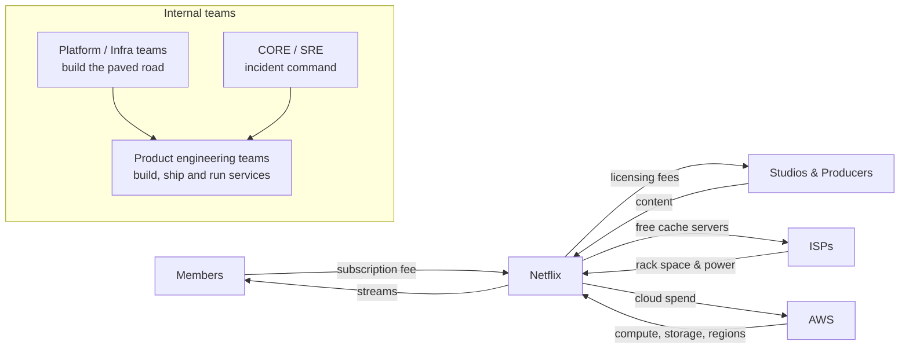
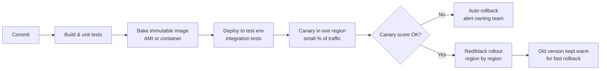

# Netflix: What DevOps Needs to Keep a Global Streaming Service Running

## Executive Summary

Netflix is a subscription streaming service with over 300 million paid memberships in more than 190 countries. That is the last figure it reported, for Q4 2024; it stopped publishing subscriber counts in 2025. Its revenue was about $39 billion in 2024. The core problem DevOps solves for Netflix is this: **thousands of engineers must ship changes every day without interrupting playback for hundreds of millions of people.** Netflix's answer is a self-service platform (the "paved road"), automated delivery with canary analysis, active-active multi-region hosting on AWS, its own CDN, and a habit of breaking things on purpose so that real failures are survivable.

> **Data labels used in this document**
> - **Reported**: Netflix has stated it publicly (tech blog, earnings, conference talks).
> - **Estimated**: a representative figure, given for illustration only.

---

## 1. What the Business Needs from Operations

Netflix earns almost all its revenue from monthly subscriptions, with an ad-supported tier added since 2022. Revenue depends on members not cancelling, and members cancel when the service stops working. That leads to four operating requirements:

| Business need | What it means for DevOps |
|---|---|
| Playback always starts | The control plane must stay available, even when a whole AWS region fails |
| Video looks good on any network | Delivery must happen close to viewers, so a CDN is required |
| New features ship quickly | Teams deploy on their own, many times a day, without a central release team |
| Costs grow more slowly than members | Capacity must autoscale, and spend must be visible per team |

### Stakeholders and who runs what

---

## 2. The Operating Model: "You Build It, You Run It"

Netflix has no traditional ops team that receives code over a wall. It has described the model in its "Full Cycle Developers" blog post (**reported**):

- **Product teams own their services end to end**: design, deploy, on-call and capacity.
- **Platform teams build the tools**: deployment, telemetry, container runtime, data stores. Teams are encouraged, not forced, to use them. This is the **"paved road"**: the easiest way to work is also the supported, safe way.
- **A central reliability team (CORE)** leads major incidents and runs cross-company resilience work.
- **The culture is "context, not control"**: engineers get the information to make good decisions, not approval gates.

**Lesson:** this model only works because of the platform. Without self-service tools, "you build it, you run it" just turns every developer into a part-time sysadmin.

---

## 3. What It Takes to Run Netflix: Layer by Layer

### 3.1 Cloud and Hosting

- **Purpose:** host the control plane, meaning everything except the video bytes: sign-up, browse, recommendations, playback authorization and billing.
- **What Netflix uses:** AWS. Netflix finished moving out of its own data centres in 2016, after a 2008 database corruption incident stopped DVD shipments for three days (**reported**). It runs **active-active across three AWS regions** (US East, US West, EU West) (**reported**).
- **Why it matters at this scale:** any single region can be "evacuated", meaning all its traffic moves to the other two within minutes. That turns a regional cloud outage into a non-event for members.

### 3.2 Compute and Containers

- **Purpose:** run thousands of microservices and batch jobs.
- **What Netflix uses:** EC2 instances grouped in autoscaling groups, plus **Titus**, Netflix's own container platform (open-sourced). Images are immutable: servers are replaced, never patched in place.
- **Why it matters:** traffic follows a daily cycle, peaking in the evening in each region. Autoscaling plus predictive scaling (Netflix's earlier "Scryer" work) keeps capacity just ahead of demand.

### 3.3 Networking, Edge and CDN

- **Purpose:** get requests into the right service, and get video to the viewer from as close as possible.
- **What Netflix uses:**
  - **Zuul**: the API gateway that does routing, auth, rate limiting and traffic shifting during region evacuation.
  - **Eureka** for service discovery and AWS load balancers at the edge.
  - **Open Connect**: Netflix's own CDN. Netflix gives cache appliances to ISPs and places them in internet exchanges at no cost. Popular titles are pre-loaded overnight, during off-peak hours (**reported**).
- **Why it matters:** video is the large majority of Netflix's bandwidth. Serving it from inside ISP networks cuts latency and transit cost, and keeps AWS out of the bulk-bytes path.

### 3.4 Data Layer

| Need | Technology (**reported**) | Why |
|---|---|---|
| Member state, viewing history | Apache Cassandra | Multi-region writes, no single primary |
| Low-latency reads | EVCache (memcached-based) | Personalized home pages are served from cache |
| Billing and finance | Relational databases | Needs transactions and audit trails |
| Analytics | S3 data lake with Apache Iceberg (created at Netflix) | Petabyte-scale tables with schema evolution |

### 3.5 Streaming and Messaging

- **Purpose:** move events (plays, pauses, errors, logs) from devices and services to analytics and ML.
- **What Netflix uses:** the **Keystone** pipeline, built on Apache Kafka and Apache Flink. Netflix has described it as processing trillions of events per day (**reported**).
- **Why it matters:** the same event stream feeds recommendations, playback quality monitoring, A/B test results and operational alerts.

### 3.6 Security and Compliance

- **Purpose:** protect member accounts and payment data, and protect licensed content.
- **What Netflix uses:**
  - Short-lived, least-privilege AWS credentials. Netflix open-sourced tools such as Lemur for certificate management and ConsoleMe for IAM access.
  - DRM (Widevine, PlayReady, FairPlay), because studios require it under licensing contracts.
  - PCI DSS scope for card payments, kept small by tokenizing through payment processors.
  - GDPR and other regional privacy laws.
- **Why it matters:** a content leak or an account-takeover wave hurts studio relationships and member trust.

### 3.7 Observability

- **Purpose:** know within seconds when members can't press play, and find out why.
- **What Netflix uses:** **Atlas** (in-memory time-series metrics, open-sourced), **Mantis** (real-time stream processing for operational data), distributed tracing, and central logging.
- **The key metric:** **SPS (stream starts per second)**. Netflix watches it against its predicted value, which follows a regular daily pattern. A sudden gap between the two is the strongest single signal that something is wrong (**reported**).
- **Why it matters:** with thousands of services, CPU-level alerts are noise. Business-level metrics such as SPS tell you whether members are affected.

### 3.8 DevOps and CI/CD

- **Purpose:** let any team ship safely, many times a day.
- **What Netflix uses:**
  - **Spinnaker**, Netflix's open-source continuous delivery platform (2015), built with Google and others.
  - **Kayenta / Automated Canary Analysis**: the new version gets a small slice of traffic and is compared statistically with the old version. A bad canary rolls back automatically.
  - Red/black (blue/green) deployments: the old server group stays warm for instant rollback.
- **Why it matters:** at thousands of changes per day, humans can't review every rollout. The pipeline itself has to be the safety net.

### 3.9 AI/ML and Analytics

- **Purpose:** decide what each member sees, and run the business.
- **Uses:** home page ranking, personalized artwork, encoding optimization (per-title and per-shot encoding to save bandwidth), content demand forecasting, and capacity forecasting.
- **What DevOps provides:** GPU/CPU training capacity, ML workflow orchestration (Netflix open-sourced **Metaflow**), a feature store and data lineage, and an experimentation platform to A/B test every change.

### 3.10 Resilience and Disaster Recovery

- **Purpose:** survive instance, zone, region and dependency failures without member impact.
- **What Netflix does (**reported**):**
  - **Chaos Monkey** (2011) randomly terminates production instances, so every service must tolerate losing a node.
  - The Simian Army, and later **ChAP** (the Chaos Automation Platform), inject failures and latency into live traffic on a controlled small slice.
  - Regular **region evacuation drills**.
  - Fallbacks everywhere: if personalization fails, show a generic popular-titles row instead of an error.
- **RTO/RPO (estimated):** for the control plane, about minutes for RTO (region evacuation) and near-zero for RPO, because Cassandra replicates across regions.

---

## 4. Summary Table

| Layer | Purpose | Example tech | Scale consideration |
|---|---|---|---|
| Cloud & hosting | Control plane hosting | AWS, 3 regions active-active | Survive a full region loss |
| Compute | Run services and jobs | EC2 ASGs, Titus | Daily traffic cycle, autoscaling |
| Networking & CDN | Routing and video delivery | Zuul, Eureka, Open Connect | Most bandwidth served from inside ISPs |
| Data | State and analytics | Cassandra, EVCache, S3 + Iceberg | Multi-region writes, PB-scale lake |
| Messaging | Event transport | Kafka, Flink (Keystone) | Trillions of events/day |
| Security | Accounts, payments, content | IAM, DRM, tokenized payments | PCI scope kept small, studio contracts |
| Observability | Detect and diagnose | Atlas, Mantis, tracing | Alert on SPS, not CPU |
| CI/CD | Safe frequent shipping | Spinnaker, Kayenta canaries | Thousands of changes/day |
| AI/ML | Personalization, encoding | Metaflow, experimentation platform | Every change A/B tested |
| Resilience | Survive failure | Chaos Monkey, ChAP, evacuation | Failure treated as normal |

---

## 5. Key Challenges and How They Were Solved

### Challenge 1: The data centre was a single point of failure
- **Problem:** the 2008 database corruption stopped the business for days (**reported**).
- **Response:** a seven-year migration to AWS, redesigning around stateless services and distributed databases, not lifting and shifting.

### Challenge 2: Cloud outages are outside your control
- **Problem:** AWS regional incidents, including the widely reported AWS load-balancer outage on Christmas Eve 2012, took Netflix down.
- **Response:** active-active multi-region, Zuul-based traffic steering, and regular evacuation drills, so that losing a region is a routine operation.

### Challenge 3: Thousands of services, thousands of deploys
- **Problem:** manual release checks don't scale, and one bad deploy can affect every member.
- **Response:** Spinnaker plus automated canary analysis, immutable images and instant red/black rollback.

### Challenge 4: Live events break the on-demand playbook
- **Problem:** on-demand traffic is predictable and can be pre-cached. Live events create sudden, synchronized peaks. Netflix's November 2024 live boxing event had widely reported buffering for some viewers.
- **Response (reported in general terms):** dedicated live-streaming infrastructure and capacity planning, and an investment in live encoding and delivery that was tested on later live events. **Lesson:** a new traffic shape needs new load tests, even for a mature platform.

---

## 6. Results and Impact

| Outcome | Figure | Label |
|---|---|---|
| Global reach | 190+ countries | Reported |
| Paid memberships | 300M+ (Q4 2024, last reported) | Reported |
| Regions | 3 AWS regions, active-active | Reported |
| Production changes | Thousands per day | Reported (approximate) |
| Region evacuation time | Minutes | Reported (approximate) |
| Event volume | Trillions/day through Keystone | Reported |
| Control-plane availability target | 99.99%+ | Estimated |
| Video bandwidth via Open Connect | Nearly all | Reported |

---

## 7. Blueprint: What a Smaller Streaming or Content Company Needs

Costs are **estimated** monthly cloud spend, not counting content licensing or staff.

### Phase 1: MVP (0–10k users) · ~$500–$3,000/month
- One cloud region and a managed platform (ECS/Fargate, Cloud Run or App Runner)
- Managed Postgres plus a Redis cache
- A video platform as a service (Mux, Cloudflare Stream, AWS IVS/MediaConvert) instead of your own encoding
- A commercial CDN (CloudFront, Cloudflare)
- GitHub Actions CI, Terraform for infrastructure, and one-click rollback
- Basic observability: uptime checks, logs, and a "plays started" metric

### Phase 2: Growth (10k–1M users) · ~$10,000–$80,000/month
- Kubernetes (EKS/GKE) once there are more than about 10 services
- Multi-AZ everything, and read replicas
- Kafka or a managed event bus for viewing events
- An ArgoCD/GitOps deployment flow with canary releases (Argo Rollouts, Flagger)
- Prometheus and Grafana, tracing with OpenTelemetry, SLOs and on-call rotation
- A data warehouse (BigQuery, Snowflake) and a first recommendation model

### Phase 3: Scale (1M+ users) · ~$150,000–$1M+/month
- Multi-region active-passive first, then active-active
- Multi-CDN, or edge caches with ISPs in your largest markets
- An internal developer platform (Backstage) as your "paved road"
- Chaos experiments in staging, then in production
- A FinOps practice: cost per stream start, per team

---

## 8. Key Takeaways

1. **Pick one business metric as the main health signal.** Netflix uses stream starts per second. Find your equivalent: orders, payments, logins.
2. **Build a paved road before you require ownership.** Self-service tools are what make "you build it, you run it" fair.
3. **Automate the go/no-go decision.** Canary analysis with automatic rollback scales better than review meetings.
4. **Practise failure.** A failover that has never been drilled is only a plan.
5. **Plan for degraded modes.** A generic answer is better than an error page.

---

## 9. How This Repo Helps

The building blocks for Phases 1–2 are in this toolkit:

- Infrastructure as code: [`tools/devops/terraform`](../../tools/devops/terraform), [`tools/devops/aws`](../../tools/devops/aws)
- Containers and orchestration: [`tools/devops/docker`](../../tools/devops/docker), [`tools/devops/kubernetes`](../../tools/devops/kubernetes)
- GitOps delivery: [`tools/devops/argocd`](../../tools/devops/argocd)
- Events: [`tools/devops/kafka`](../../tools/devops/kafka)
- Observability: [`tools/devops/prometheus-grafana`](../../tools/devops/prometheus-grafana), [`tools/devops/elk-stack`](../../tools/devops/elk-stack)
- Secrets: [`tools/devops/vault`](../../tools/devops/vault)

---

## Sources (public)

- Netflix Technology Blog (netflixtechblog.com): posts on the AWS migration, Full Cycle Developers, Spinnaker, Automated Canary Analysis / Kayenta, Keystone, Titus, ChAP, Atlas, Zuul and EVCache
- Netflix Open Connect overview (openconnect.netflix.com)
- Netflix quarterly shareholder letters (ir.netflix.net)
- Conference talks by Netflix engineers (AWS re:Invent, QCon)

*Figures marked "estimated" are illustrative and are not Netflix data.*
