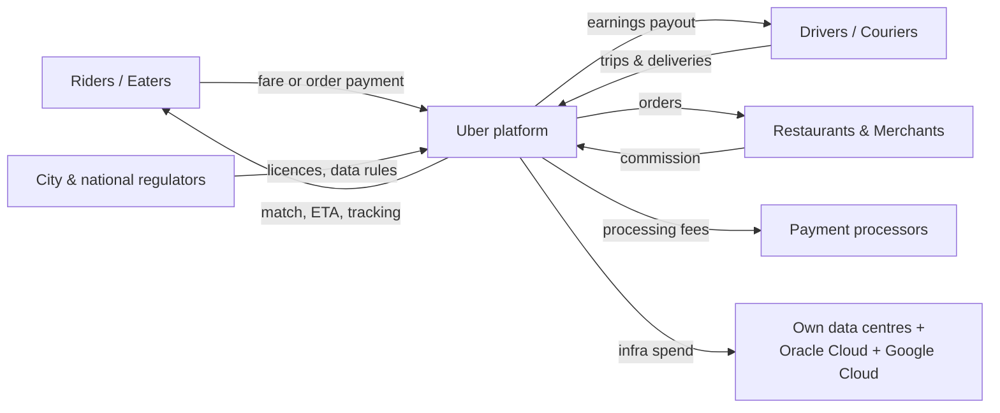
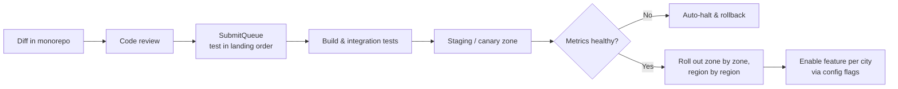

# Uber: What DevOps Needs to Run a Real-Time Marketplace

## Executive Summary

Uber connects riders, eaters, drivers, couriers, merchants and freight shippers in 70+ countries. In 2024 it reported about $44 billion in revenue, more than 11 billion trips, and about 170 million monthly active consumers (**reported**). Unlike streaming or banking, Uber's product is a **live match between two moving parties**: a request that fails or slows down is a lost trip for the rider and lost income for the driver. The core problem DevOps solves for Uber is **keeping a location-aware, real-time system available and fast through sudden demand spikes, while thousands of engineers change it every day.**

> **Data labels used in this document**
>
> - **Reported**: Uber has stated it publicly (engineering blog, annual report, talks), or it was widely covered in the press.
> - **Estimated**: a representative figure, given for illustration only.

---

## 1. What the Business Needs from Operations

Uber takes a percentage of every trip and delivery (the "take rate"), and also earns from advertising, Uber One memberships and freight. Every source depends on the same loop: **request → match → move → pay**, completed in seconds.

| Business need | What it means for DevOps |
|---|---|
| Matches in seconds | Dispatch and pricing must be low-latency and close to users |
| Works during spikes (New Year's Eve, rain, concerts) | Capacity and load-shedding plans for 5–10x normal demand (estimated) |
| Trip never "lost" mid-ride | Trip state must survive a data centre or region failure |
| Drivers get paid correctly | Payments and earnings systems need correctness and audit trails |
| Different rules in every city | Configuration and feature flags per market, without redeploying |

### Stakeholders and how value moves

---

## 2. Operating Model

What Uber has described publicly (**reported**):

- **Thousands of microservices.** In 2020 Uber described around 2,200 critical microservices. That led to **DOMA (Domain-Oriented Microservice Architecture)**, which groups services into domains behind gateways so teams don't need to know about each other's internal services.
- **Monorepos per language** (Go, Java and others). A system called **SubmitQueue** keeps the main branch always green by testing changes in order before they land.
- **Service owners run their services**, with a central platform organization providing compute, storage, deployment, observability and developer tools.
- **Ownership is recorded in tooling**: every service has an owning team, an on-call rotation and a tier (criticality level) that controls how it is deployed and alerted on.

**Lesson:** microservices solve team scaling problems, but past a certain number they create a new one. DOMA reflects a mature view: microservices still need structure.

---

## 3. What It Takes to Run Uber: Layer by Layer

### 3.1 Cloud and Hosting

- **Purpose:** host the marketplace (dispatch, pricing, trips, payments, maps) and the large data platform.
- **What Uber uses:** Uber ran mostly in **its own data centres** for years. In 2023 it announced seven-year agreements to move large parts of its infrastructure to **Oracle Cloud and Google Cloud** (**reported**). That makes Uber a **hybrid, multi-cloud** company during the transition.
- **Why it matters:** at Uber's size, owning hardware can be cheaper than the cloud, but it makes capacity, hardware refresh and new regions harder. Running across several providers needs a **cloud-agnostic platform layer**, so services don't care where they run.

### 3.2 Compute and Containers

- **Purpose:** run stateless services, stateful systems and large batch/ML workloads on shared infrastructure.
- **What Uber uses:** containers scheduled on Apache Mesos with Uber's own **Peloton** scheduler for years, then a **large migration to Kubernetes** (**reported**). Deployment goes through Uber's **Up** platform, which places services across zones and providers (**reported**).
- **Why it matters:** sharing one compute pool between online services and batch jobs raises utilization. That is a large cost lever when you run hundreds of thousands of cores (**estimated**).

### 3.3 Networking and Edge

- **Purpose:** get mobile requests from all over the world to the right region quickly, and route between services.
- **What Uber uses:** global edge/API gateways, region-aware routing, and an internal RPC stack with service discovery and load balancing. Uber's open-source **H3** hexagonal grid is used to index locations, so supply, demand and pricing can be computed per small area (**reported**).
- **Why it matters:** mobile networks are unreliable. Uber has written about optimizing its mobile networking (for example, trying QUIC) to reduce latency and failed requests on poor connections (**reported**).

### 3.4 Data Layer

| Need | Technology (**reported**) | Why |
|---|---|---|
| Trip and core service data | **Schemaless** and later **Docstore**, Uber's own layers over MySQL | Horizontal scale with familiar MySQL operations |
| Wide-column workloads | Apache Cassandra | High write throughput |
| Caching | Redis (with Uber's own caching layers) | Hot reads such as driver locations and ETAs |
| Data lake | HDFS/object storage with **Apache Hudi** (created at Uber), Hive, Spark, Presto | Incremental updates to petabyte-scale tables |
| Real-time analytics | **Apache Pinot** | Live dashboards such as orders per minute per restaurant |

**Lesson:** Uber moved trip data off a single Postgres database in 2014 ("Project Mezzanine", **reported**). The trigger was growth, not fashion. Move only when you can measure the limit you are hitting.

### 3.5 Streaming and Messaging

- **Purpose:** carry driver location updates, trip events, payments events, logs and metrics.
- **What Uber uses:** **Apache Kafka**, one of the largest deployments in the industry, with trillions of messages per day (**reported**), plus Apache Flink for stream processing. Long-running business processes (such as payouts and onboarding steps) run on **Cadence**, a durable workflow engine created at Uber (**reported**). Temporal is a fork of it by Cadence's original authors.
- **Why it matters:** surge pricing, ETAs, fraud checks and live dashboards all depend on events arriving within seconds.

### 3.6 Security and Compliance

| Area | Requirement | Typical controls |
|---|---|---|
| Payments | **PCI DSS** | Tokenization, small card-data scope, processor partnerships |
| Personal and location data | **GDPR**, CCPA and local laws | Data minimization, access logging, retention limits |
| Cross-border data | EU data transfer rules | Data residency controls, transfer agreements |
| Platform work | Local transport and labour rules | Per-market configuration and reporting |
| Corporate security | SOC 2 style controls, SOX (public company) | Phishing-resistant MFA, least privilege, audit trails |

Two public incidents shaped Uber's security approach (**reported**):

- **2016:** attackers used cloud credentials found in a code repository to access stored data on about 57 million users. Uber did not disclose it for a year, and later paid a $148 million settlement to US states.
- **2022:** an attacker got a contractor's password and repeatedly sent MFA push requests until one was approved ("MFA fatigue"), then found admin credentials in an internal script.
- **Related regulatory action:** in 2024 the Dutch data protection authority fined Uber €290 million over transfers of European drivers' data to the US.

DevOps controls these incidents point to:

- **No secrets in code.** Use secret scanning in CI and a vault with short-lived credentials.
- **Phishing-resistant MFA** (hardware keys or number matching), not simple push approval.
- **Least privilege for admin tools**, with just-in-time access.
- **Data residency built into the platform**, not left to each team.

### 3.7 Observability

- **Purpose:** spot problems in one city or one product line quickly, across thousands of services.
- **What Uber uses (**reported**, all created at Uber):**
  - **M3**: a metrics platform built to handle billions of time series
  - **Jaeger**: distributed tracing, now a CNCF graduated project
  - **uMonitor**: alerting
  - Centralized logging
- **Key signals (representative):** trips requested vs completed per city, time to match, payment success, app crash rate, and driver location update lag.
- **Why it matters:** failures in a marketplace are often **local**. One city's demand spike, or one payment method failing in one country, can disappear in global averages. Metrics need per-city and per-product dimensions.

### 3.8 DevOps and CI/CD

- **Purpose:** let thousands of engineers ship continuously without breaking the trip flow.
- **What Uber does (**reported**):** monorepos with SubmitQueue, automated tests, deployment through **Up** with **staged rollouts** (one zone, then one region, then everywhere), and automatic checks that stop a rollout if metrics get worse. Feature flags and dynamic configuration (Uber's **Flipr**) change behaviour per city without a deploy.

- **Why it matters:** separating **deploy** (code is live) from **release** (users see it) lets Uber test a feature in one city and switch it off immediately if something goes wrong.

### 3.9 AI/ML and Analytics

- **Uses:** ETA prediction, surge pricing, matching, fraud detection, Uber Eats ranking, and demand forecasting for driver positioning.
- **What Uber uses:** **Michelangelo**, Uber's own ML platform, which covers features, training, deployment and monitoring (**reported**). Many models make predictions online, inside the request path.
- **What DevOps provides:** low-latency model serving, a feature store fed by Kafka/Flink, GPU capacity, and model monitoring for drift. A bad ETA model hurts customers immediately, so models need the same rollout and rollback controls as code.

### 3.10 Resilience and Disaster Recovery

- **Purpose:** keep trips going when a zone, data centre or region fails.
- **Practices (**reported** in general terms):**
  - **Multi-region active-active** for core trip flows, with regular failover drills
  - The mobile app can **keep trip state on the device** and resend it, so a trip in progress survives a back-end failover
  - **Load shedding** by request priority: under overload, finishing an active trip comes before loading the promotions screen
  - Capacity tests before known peaks such as New Year's Eve
- **RTO/RPO (estimated):** for the trip flow, about minutes for RTO (regional failover) and near-zero RPO for active trips.

---

## 4. Summary Table

| Layer | Purpose | Example tech | Scale consideration |
|---|---|---|---|
| Cloud & hosting | Run marketplace and data platform | Own data centres → Oracle Cloud + Google Cloud | Hybrid needs a cloud-agnostic platform |
| Compute | Shared pool for services, batch, ML | Mesos/Peloton → Kubernetes, Up | Utilization is the main cost lever |
| Networking | Fast global mobile access | Edge gateways, H3 geo-indexing | Unreliable mobile networks |
| Data | Trips, users, analytics | Schemaless/Docstore, Cassandra, Redis, Hudi, Pinot | Petabyte lake, real-time dashboards |
| Messaging | Locations, events, workflows | Kafka, Flink, Cadence | Trillions of messages/day |
| Security | Protect people, payments, data | Vault, MFA, PCI DSS, GDPR | Past breaches, data residency fines |
| Observability | Find local failures fast | M3, Jaeger, uMonitor | Per-city dimensions |
| CI/CD | Continuous safe change | Monorepo, SubmitQueue, Up, Flipr | Deploy ≠ release |
| AI/ML | ETAs, pricing, fraud | Michelangelo | Models in the request path |
| Resilience | Survive region loss and peaks | Active-active, load shedding | New Year's Eve demand |

---

## 5. Key Challenges and How They Were Solved

### Challenge 1: The monolith couldn't keep up

- **Problem:** Uber's early Python monolith and single Postgres database couldn't handle growth (**reported**).
- **Response:** a move to microservices and Schemaless, with trip data moved in "Project Mezzanine" (2014).

### Challenge 2: Too many microservices

- **Problem:** with thousands of services, a single feature could touch dozens of teams, and understanding dependencies became hard.
- **Response:** **DOMA**: group services into domains with gateways and clear interfaces, and limit who can call what.

### Challenge 3: Security incidents through credentials

- **Problem:** the 2016 and 2022 incidents both started with credentials, in a code repository and through MFA fatigue (**reported**).
- **Response:** secret scanning, stronger MFA, tighter access to admin tools and better detection. **Lesson:** most breaches start with identity, not exotic exploits.

### Challenge 4: Owning data centres limited speed

- **Problem:** hardware purchasing, refresh cycles and opening new regions are slow and capital-heavy.
- **Response:** the 2023 multi-cloud agreements with Oracle and Google, plus a platform layer (Kubernetes + Up) so services can move without being rewritten.

---

## 6. Results and Impact

| Outcome | Figure | Label |
|---|---|---|
| Revenue (2024) | ~$44bn | Reported |
| Trips (2024) | 11bn+ | Reported |
| Monthly active platform consumers | ~170M (Q4 2024) | Reported |
| Critical microservices | ~2,200 (2020) | Reported |
| Kafka throughput | Trillions of messages/day | Reported |
| Open-source projects from Uber | Jaeger, M3, H3, Cadence, Hudi, Peloton, and more | Reported |
| Core trip flow availability target | 99.99% | Estimated |

---

## 7. Blueprint: What a Smaller Marketplace Needs

This applies to ride-hailing, delivery, home services or any two-sided, location-based marketplace. Costs are **estimated** monthly cloud spend, not counting map/SMS API fees or staff.

### Phase 1: MVP (one city) · ~$500–$3,000/month

- One cloud region, managed containers (Cloud Run, ECS/Fargate) and managed Postgres with **PostGIS** for location queries
- Redis for live driver locations
- Maps, routing and SMS from APIs (Google Maps, Mapbox, Twilio). Payments via Stripe or Razorpay, which keeps PCI scope minimal
- GitHub Actions + Terraform, secret scanning from day one, and MFA everywhere
- One dashboard: requests vs completed matches

### Phase 2: Growth (several cities) · ~$10,000–$75,000/month

- Kubernetes, multi-AZ, and a split into a few domains (riders, drivers, trips, payments), not dozens of services
- Kafka or a managed stream for location and trip events, and a workflow engine (Temporal) for payouts and onboarding
- Feature flags per city (LaunchDarkly, Unleash, Flagsmith)
- Prometheus/Grafana and OpenTelemetry, with per-city metrics, SLOs and on-call
- First ML models: ETA and demand forecasting

### Phase 3: Scale (national or multi-country) · ~$150,000–$1M+/month

- Multi-region, with trip state kept on the device for failover
- Priority-based load shedding and pre-peak load testing
- Data residency per country, and a data lake (Hudi/Iceberg) plus real-time analytics (Pinot, ClickHouse)
- An internal developer platform, domain gateways (DOMA-style) and an ML platform
- Dedicated SRE, security and FinOps teams

---

## 8. Key Takeaways

1. **Measure locally, not just globally.** In a marketplace, one city can be down while global averages look fine.
2. **Separate deploy from release.** Feature flags per market turn risky launches into reversible experiments.
3. **Give microservices structure.** Group services into domains before there are too many to understand.
4. **Protect identity first.** Secret scanning and phishing-resistant MFA would have stopped both of Uber's major breaches.
5. **Rank requests by priority.** When overloaded, protect the core flow (active trips) and drop the extras.

---

## 9. How This Repo Helps

- Events and workflows: [`tools/devops/kafka`](../../tools/devops/kafka)
- Platform: [`tools/devops/kubernetes`](../../tools/devops/kubernetes), [`tools/devops/terraform`](../../tools/devops/terraform), [`tools/devops/argocd`](../../tools/devops/argocd)
- Observability: [`tools/devops/prometheus-grafana`](../../tools/devops/prometheus-grafana), [`tools/devops/elk-stack`](../../tools/devops/elk-stack)
- Secrets and security scanning: [`tools/devops/vault`](../../tools/devops/vault), [`tools/devsecops`](../../tools/devsecops), [`security`](../../security)
- Payments patterns: [`projects/payments-api`](../payments-api)

---

## Sources (public)

- Uber Engineering Blog (uber.com/blog/engineering): posts on DOMA, Schemaless and Docstore, Project Mezzanine, SubmitQueue, Peloton, the Kubernetes migration, Up, M3, Jaeger, H3, Cadence, Hudi, Michelangelo and Flipr
- Uber annual reports and quarterly results (investor.uber.com)
- Public statements and press coverage of the 2016 and 2022 security incidents, and the 2023 Oracle and Google Cloud agreements
- Dutch Data Protection Authority (Autoriteit Persoonsgegevens) decision, August 2024

*Figures marked "estimated" are illustrative and are not Uber data. Check reported figures against the latest filings before publishing.*
